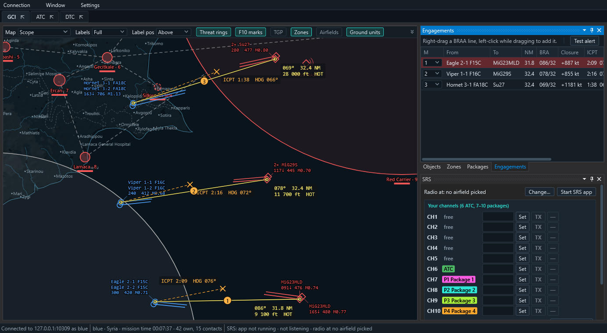
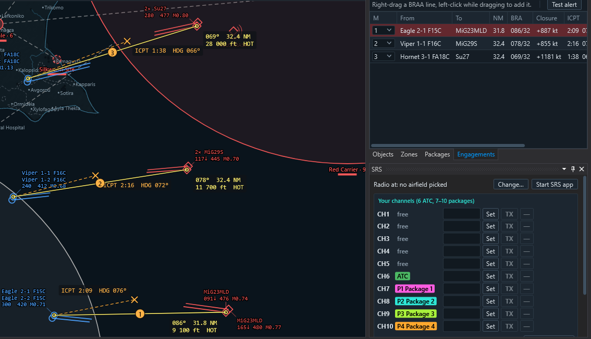
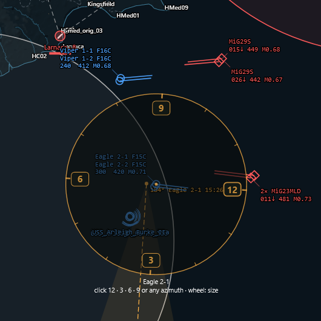
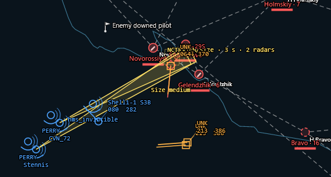
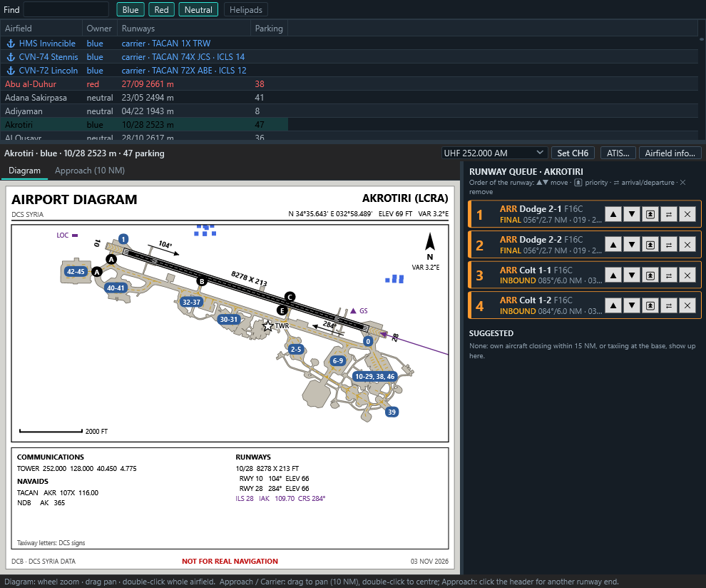
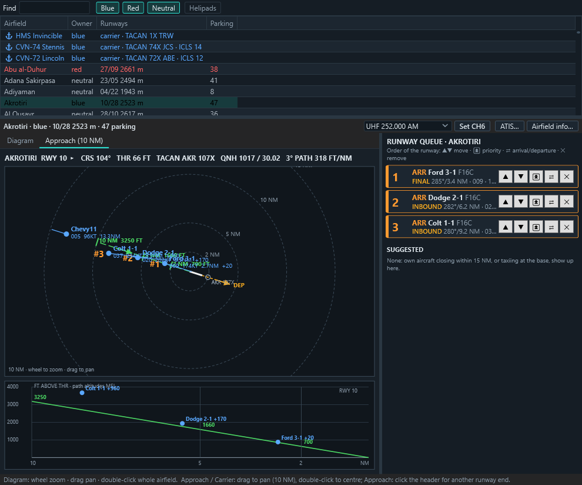
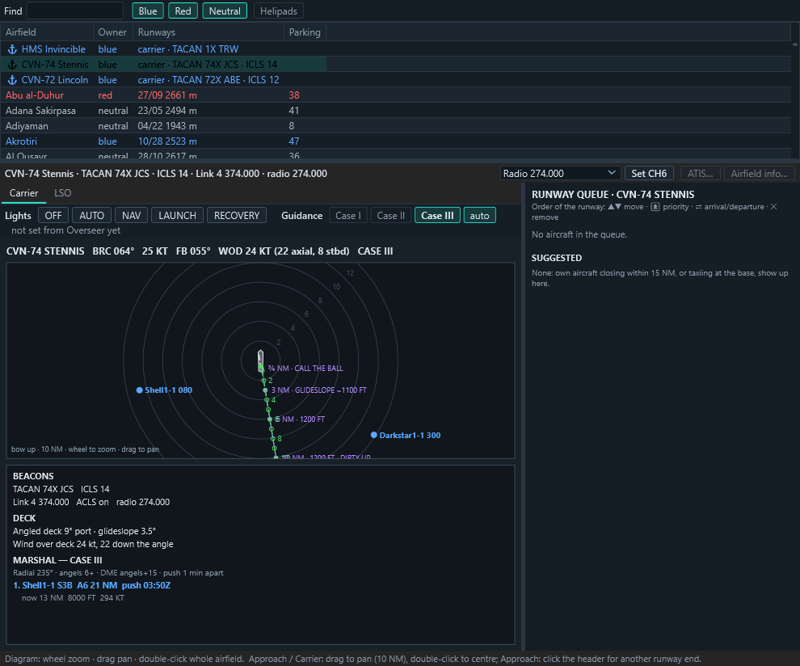
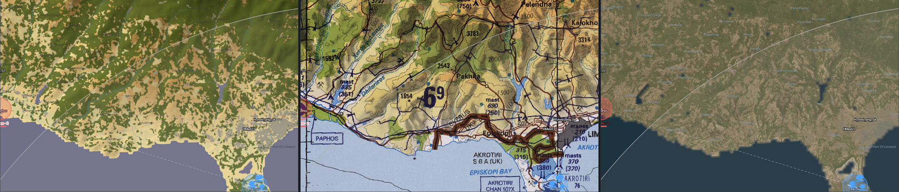
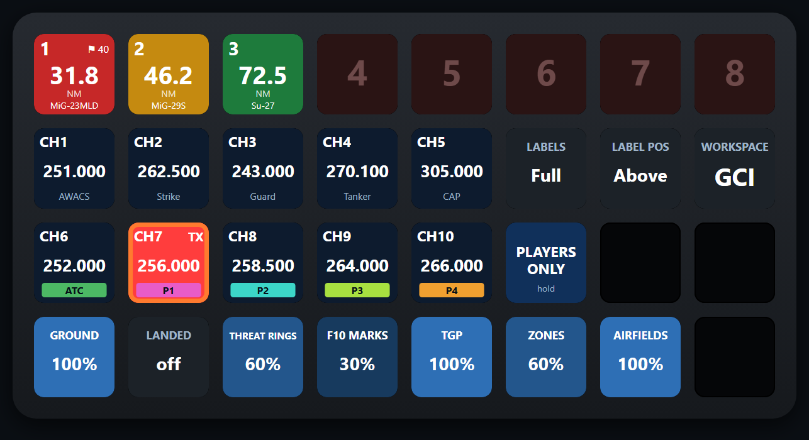

# Overseer
*by Kestrel's Nest Community*

**A GCI and ATC controller station for DCS World multiplayer servers. Free and open source.**
Formerly known as Eagle's Nest.

Your controllers sit at their own PC and see what your coalition's radars see — no more. They
call BRAA and bullseye, run intercepts, identify contacts, work the tower and the carrier and
talk on SRS, all from one screen.

<a href="https://github.com/kestrelsnest/eagles-nest-releases/releases"><b>Download</b></a> ·
<a href="docs/MANUAL.md"><b>Manual</b></a> ·
<a href="#support-the-project"><b>Support the project</b></a>

---

## Why Overseer

- **Real fog of war.** The picture is built on the DCS server from your side's own sensors and
  sent to your side only. An enemy jet no radar of yours holds never leaves the server.
- **Radars sweep, identities are earned.** An AWACS refreshes every 10 s, a SAM search radar
  every second or two. Contacts can arrive as unknowns: you identify them from pilots' RWR calls
  and NCTR (JEM, HRRP, ISAR, size, rotor, raid count), each with its own range and aspect rules.
- **Built from DCS itself.** Maps, charts, satellite imagery, airport diagrams and the pilots'
  data cartridge formats come from the controller's own DCS install — nothing to download.
- **GCI and ATC in one.** Intercepts and engagement lines next to runway queues, approaches,
  marshal and LSO grading.
- **Light on the server.** Measured on two busy Foothold servers: about 3–7 ms of the server's
  time per second, spread so that no frame carries more than one DCB job; while nobody is
  controlling, the picture slows to one every 5 s.

---

## Get started

### Run it on your server (admins)
1. Download `Overseer-Server-<version>.zip` from the
   [Releases page](https://github.com/kestrelsnest/eagles-nest-releases/releases).
2. Stop the DCS server and copy the contents of `copy-into-saved-games` into its Saved Games folder.
3. Open TCP port 10309 for your controllers.
4. Start the server. The first start writes `Config\DCB.lua` with a random password.
5. Give the password to your controllers (or switch on Discord role login).

### Control (controllers)
1. Install the [.NET 10 Desktop Runtime](https://dotnet.microsoft.com/download/dotnet/10.0) (x64) once.
2. Download `Overseer-Client-<version>.zip` and start `Dcb.Client.exe`.
3. Confirm your DCS World install when asked (it must be installed, not running).
4. Connection → Connect → New: the server's address, port 10309, the password.
5. Pick your side — then read the [manual](docs/MANUAL.md).

### Fly with it (pilots)
Nothing to install to fly with a controller: you hear them on SRS as usual. Two optional extras
come in `Overseer-Pilot-<version>.zip`:
- **Data cartridges** (work in progress): add one hook file and your controller can push a complete DTC
  (waypoints, threats, radios, countermeasures) for the F/A-18C, F-16C or F-14B(U).
- **Share your targeting pod:** F-16C and F/A-18C pilots can send their TGP / ATFLIR point.

---

## What you get

### GCI
Speed vectors, data blocks with altitude, speed and Mach, threat rings, missiles in flight
(launches at your players sound an alarm), bullseye under the cursor, a BRAA ruler, packages in
colour, Foothold campaign zones. Flights in formation share one label; labels never cover a
symbol, a vector or each other.

### Engagements
Pin a BRAA line between two aircraft: it follows both and shows the **collision intercept** —
point, time and heading to fly. The Engagements panel ranks them, sounds a short warning at
your alert range, and keys 1–8 (or the Stream Deck) jump the map to each one.

### Identification, RWR and NCTR
An own aircraft's RWR ring turns with its nose: click the clock position a pilot calls for a
bearing line; two lines give a fix with its error. NCTR by your AI radars works a box you drag,
with its cones on the map.

| | |
|---|---|
|  |  |
| The RWR ring turns with the jet: a pilot's "3 o'clock" becomes a bearing line | NCTR: the radars' cones on a contact |

### ATC and carrier
Airport diagrams from DCS data (runways, taxiway letters, stands, navaids), a 10 NM approach
view with 3° path altitudes, runway queues, ATIS sent to a pilot's screen, the carrier with BRC,
wind over deck and marshal stack, and LSO grading.

| | | |
|---|---|---|
|  |  |  |
| Airport diagram and runway queue | 10 NM approach | Carrier and marshal |

### Data cartridges for your pilots — *work in progress*
Plan waypoints, routes, threat rings, radios, CMDS, RWR and HARM tables, JDAM targets on the map —
in DCS's own formats and limits, one plan for all three jets — and push it to a pilot or a
whole package. Each pilot gets the cartridge of the jet they fly.

> The DTC is still being built: it works for the F/A-18C, F-16C and F-14B(U), but expect gaps
> and changes between releases. Reports from pilots who try it are very welcome.

### Maps, radio and the Stream Deck
- Base maps: Scope, DCS Map, DCS Charts and DCS Satellite from your own install, and online
  satellite imagery.
- **SRS:** tunes your SRS client, sends your radio position (or the best spot for a player),
  and shows who is on which frequency and who is talking.
- **Stream Deck XL page:** engagements coloured by range, ten SRS channels with transmit
  highlight, map filters with four brightness steps, labels and a hold-to-show "players only".

| | |
|---|---|
|  |  |
| DCS Map, Charts and Satellite from your install | The Stream Deck XL page |

---

## Home servers

Overseer is built and run on the **Kestrel's Nest** servers — come and see it live.

**Running Overseer on your server?** [Tell us](https://github.com/kestrelsnest/eagles-nest-releases/issues)
and you can be listed here.
<!-- Servers on the Patreon "Server" tier are listed here. -->

---

## Support the project

Overseer is free, and it stays free — every feature, for every server.
A Patreon page and a Ko-fi coffee button are coming soon for those who want to help keep it going.

Bug reports and ideas are welcome: [open an issue](https://github.com/kestrelsnest/eagles-nest-releases/issues).

---

## Coming from Eagle's Nest?

Overseer is the same project under its new name (0.15.1 on). The server and the client simply
update. What was installed under the old name:
- **Pilots:** replace `Scripts\Hooks\EaglesNest-DTC.lua` with `Overseer-DTC.lua` (copy your
  server lines over) and, with designations, `EaglesNest-Export.lua` with `Overseer-Export.lua`
  plus its line in `Export.lua`. Cartridges are now saved as `Overseer_<jet>.dtc`; the old
  `EaglesNest_*.dtc` files can go. The old hook keeps working with Overseer servers meanwhile.
- **Stream Deck:** remove the old "Eagle's Nest" plugin in Stream Deck, install the Overseer
  plugin and import the `Overseer` page — keys from the old page don't carry over.

---

## Security

The connection is plain TCP: passwords and the picture are not encrypted on the way. Limit the
firewall rule to your controllers' addresses or use a VPN (Tailscale, ZeroTier, WireGuard).
Controller actions on the server are a short, checked, rate-limited and logged list, and
**controllers don't fly**: the server refuses a controller login from the address of a player
in a cockpit. Also set `allow_object_export = false` and `allow_sensor_export = false` in DCS's
own server settings; Overseer does not need them.

## License

Overseer by Kestrel's Nest Community, © 2026 Bullat951, is free software under the
[GNU GPL v3](LICENSE) with [additional permissions](LICENSE-EXCEPTION.md) (AvalonDock's MS-PL,
DCS World), from version 0.15.1; versions up to 0.15.0 were released as Eagle's Nest under MIT. Contributions: see
[CONTRIBUTING.md](CONTRIBUTING.md). Third-party components and data:
[THIRD-PARTY-NOTICES.md](THIRD-PARTY-NOTICES.md).

DCS World is a trademark of Eagle Dynamics SA. Overseer is an independent community project,
not affiliated with or endorsed by Eagle Dynamics.
