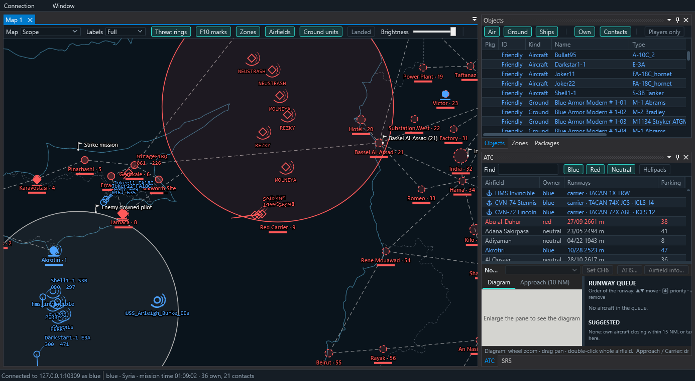
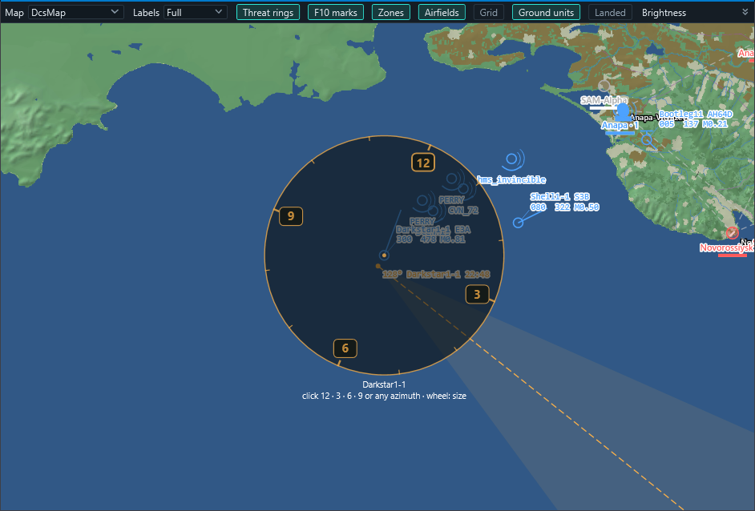
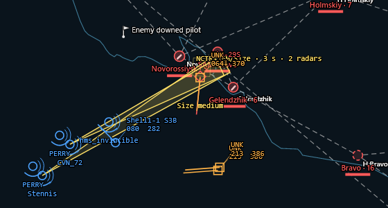
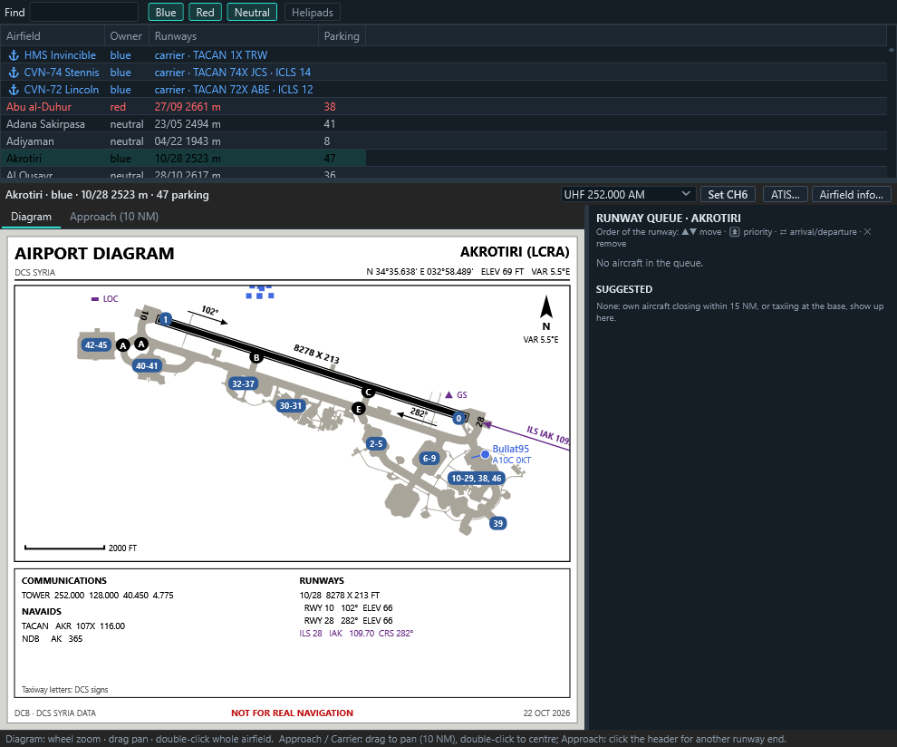
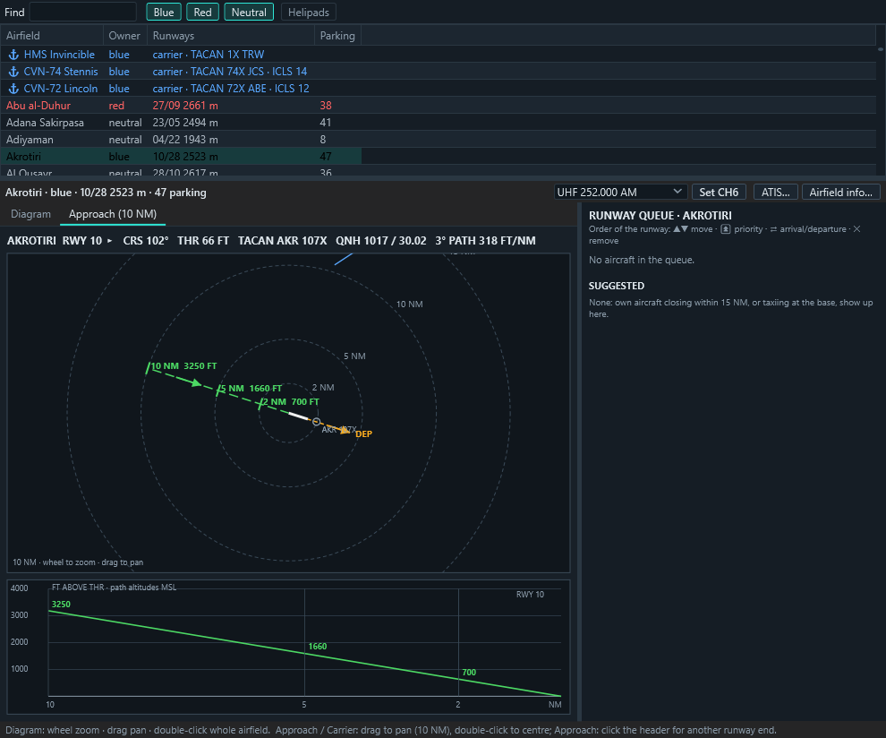
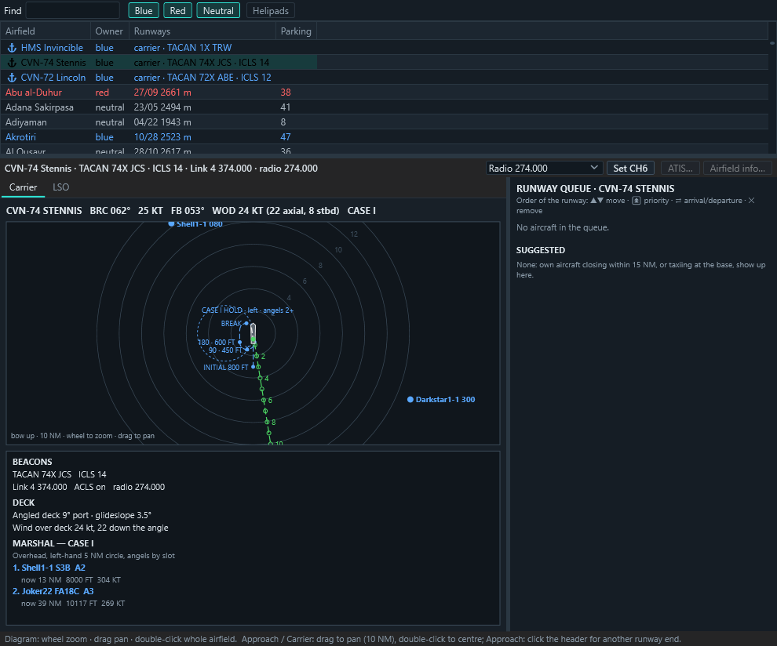

# Eagle's Nest

**An ATC / GCI controller station for DCS World multiplayer servers.**

Controllers connect from their own PC to a DCS server and get a live, fog-of-war picture of
their coalition: radar contacts, own flights, missiles, carriers and airfields. On top of that
come the tools to run the air war and the traffic around the bases: bullseye and BRAA calls,
bearing lines from pilots' RWR calls, contact identification with NCTR, triangulation of SAM
sites, airport diagrams, approach and carrier views, SRS radio integration, and F10 map marks
shared with the pilots.

> This repository holds the releases and the manual. Inside the files the project is still
> called **DCB** (`dcb.dll`, `DCB-hook.lua`, `Config\DCB.lua`).

---

## What makes it different

- **The server decides what each side sees.** The picture is built on the DCS server from your
  coalition's own sensors and sent to that coalition only. An enemy aircraft no radar of yours
  holds never leaves the server, so no client can show more than the side really knows.
- **Identification is earned, not given.** In manual mode contacts arrive as "UNK". Controllers
  work out what they are from the pilots' RWR calls and from **NCTR** on request — JEM, HRRP, ISAR, size class, rotor modulation and raid count, each
  with its own range, aspect and dwell rules. A radar doing NCTR looks along a cone; what it
  holds elsewhere freezes until it is done. You decide the identity; it turns the contact red.
- **Radars sweep.** Each of your radars refreshes what it holds at its own rate — an AWACS
  rotodome every 10 s, a carrier's radar every 6 s, a SAM search radar every second or two — so
  contacts move in steps, and a contact held by several radars updates more often.
- **One team picture.** Identities and placed threats are shared by every controller of the
  coalition; F10 marks carry threats to the pilots and bring theirs back as threat rings.
- **Built from DCS itself.** Maps, airport diagrams, taxiway letters, signs and DCS Satellite
  imagery come from the controller's own DCS install — on Syria and Caucasus alike — not from a
  tile server.
- **ATC and carrier ops, not only GCI.** Runway queues, 10 NM approach, marshal, Case I/II/III,
  carrier lighting control and graded LSO passes, alongside SRS integration.
- **Light on the server.** Measured on a busy Foothold mission (Caucasus, ~250 units, 5 blue and
  18 red radars): about **6 ms of sim-thread time per second (0.6 %)** for everything —
  picture 2.3 ms, RWR 2.0 ms (since removed), F10 marks 1.2 ms, Foothold 0.3 ms, NCTR 0.1 ms.

---

## Download

Get the latest release from the [Releases page](https://github.com/kestrelsnest/eagles-nest-releases/releases):

| Package | For | What to do |
|---|---|---|
| `EaglesNest-Client-<version>.zip` | each controller | unzip, start `Dcb.Client.exe` |
| `EaglesNest-Server-<version>.zip` | the DCS server admin | not public: ask the project for it (open an issue) |

Pilots need nothing: they fly as usual and hear the controller on SRS. To receive data cartridges
from the DTC tab they add one small hook file (in the server package, from the server admin).

---

## Features

**GCI scope**
- Per-coalition picture with fog of war: own units in full, enemy aircraft only when own radars see them.
- Speed vectors, data blocks, threat rings, missiles in flight (own, and enemy ones aimed at you).
- Bullseye call under the cursor, right-drag ruler with bearing / range / BRAA, coordinates in DDM, DMS, MGRS.
- Packages (four colour-coded groups), Foothold campaign zones, credits and mission board.
- Missiles show altitude and Mach; a missile fired at one of your players sounds an alarm and **Space** jumps to it.

**DTC: data cartridges for your pilots**
- Build whole DCS data cartridges for the **F/A-18C**, **F-16C** and **F-14B(U)** on the map: waypoints and routes with leg distances, GPS / DEST points, threat rings, lines, CAPs, radios, CMDS, RWR, HARM, JDAM targets and more, in DCS's own formats and limits.
- One plan for all three jets, or each its own. **Push** to pilots or packages: each gets the cartridge of the jet they fly, also in the spawn dialog with dynamic slots.

**RWR, identification and NCTR**
- **R** over an own aircraft opens its RWR ring, turned with its nose: click 12, 3, 6 or 9 o'clock (or any azimuth) for a bearing line from a pilot's call; two or more lines give a fix with its error ellipse.
- Data blocks show altitude, speed and Mach.
- Right-click a contact → *Identify as*: NCTR answers come first, then the RWR labels pilots call.
- **N** + drag a box: NCTR by your AI radars (JEM, HRRP, ISAR, size, rotor, raid), with cones on the map, the methods being worked flashing beside each contact and the answer or the nearest miss.
- Server setting `identification = "manual"`: contacts carry no type until a controller identifies them.

| | |
|---|---|
|  |  |
| RWR ring with a 3 o'clock bearing line; Mach in the data blocks | NCTR: two carriers' cones on a contact |

**Threats and F10 marks**
- Place a threat (SA-2 … SA-19, AAA, Patriot …) and its engagement ring appears for every controller of your side.
- Threats go to the pilots as F10 map marks; any mark a pilot types that names a threat ("SA-11 near the dam") shows up as a ring too.
- Whether enemy ground units appear on radar at all depends on the mission's era (server setting).

| | |
|---|---|
|  |  |
| Bearing lines, fix and threat ring | DCS Map base map from the controller's own DCS install |

**ATC**
- Airport diagrams drawn from DCS data: runways, taxiway letters, stands, navaids, tower, in feet.
- 10 NM approach view with 3° path altitudes, ILS/TACAN, inbound sequence and profile.
- Runway queue per airfield and carrier; ATIS and airfield information sent to a pilot's screen.
- Carrier view (BRC, wind over deck, marshal stack) and LSO view with graded passes.

| | | |
|---|---|---|
|  |  |  |
| Airport diagram | 10 NM approach | Carrier and marshal |

**Maps and radio**
- Base maps: Scope, Satellite (online), DCS Map, DCS Charts and DCS Satellite (from your DCS install).
- SRS: tunes your own SRS client, gives SRS your position for range and line of sight, and listens to the SRS server to show who is on which frequency and who is talking.
- Several windows and screens, dark and light themes, layouts kept between sessions.

---

## Quick start

**Server admin** (the server package is sent on request; details in `INSTALL.txt` inside it)
1. Stop the DCS server and copy the contents of `copy-into-saved-games` into its Saved Games folder.
2. Open TCP port 10309 for the controllers.
3. Start the server. The first start writes `Config\DCB.lua` with a random server password: give it to your controllers (Discord role login is optional).

**Controller** (details in `CLIENT.txt` inside the zip)
1. Install the [.NET 10 Desktop Runtime](https://dotnet.microsoft.com/download/dotnet/10.0) (x64) once.
2. Start `Dcb.Client.exe`. On the first start it finds your DCS World install and asks you to confirm it.
3. Connection → Connect → New: server address, port 10309, the server password; then choose Blue or Red.

Then read the **[Operations manual](docs/MANUAL.md)**.

---

## Documentation

- [Operations manual](docs/MANUAL.md): maps, keys, GCI, RWR, identification, NCTR, ATC, carrier, SRS, server settings.
- Questions and bug reports: open an issue here.

---

## Security

The connection is plain TCP: passwords and the picture are not encrypted on the way. Limit the
firewall rule to your controllers' addresses or use a VPN (Tailscale, ZeroTier, WireGuard).
Controller actions on the server are a short fixed list, checked, rate-limited and logged.
**Controllers don't fly:** the server refuses a controller login from the address of a player
sitting in a cockpit and closes it when that address takes one, so a pilot cannot watch the
coalition's picture while flying. For server admins: also set `allow_object_export = false`
and `allow_sensor_export = false` in DCS's own server settings; Eagle's Nest does not need them.

## License

[MIT](LICENSE) © 2026 Bullat951. Third-party components and data: [THIRD-PARTY-NOTICES.md](THIRD-PARTY-NOTICES.md).
DCS World is a trademark of Eagle Dynamics SA; Eagle's Nest is an independent community project.
