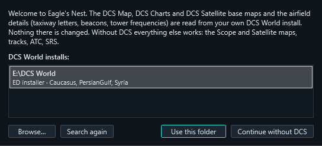
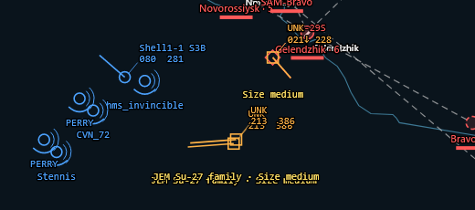

# Eagle's Nest — operations manual

For controllers (GCI and ATC). Server installation is in `INSTALL.txt` inside the server zip.

- [1. First start and connecting](#1-first-start-and-connecting)
- [2. The workspace](#2-the-workspace)
- [3. Maps](#3-maps)
- [4. Keys and mouse](#4-keys-and-mouse)
- [5. GCI](#5-gci)
- [6. RWR, identification, NCTR and threats](#6-rwr-identification-nctr-and-threats)
- [7. F10 map marks](#7-f10-map-marks)
- [8. ATC](#8-atc)
- [9. Carrier and LSO](#9-carrier-and-lso)
- [10. SRS](#10-srs)
- [11. Several screens, themes, layout](#11-several-screens-themes-layout)
- [12. DTC: data cartridges for pilots](#12-dtc-data-cartridges-for-pilots)
- [13. For the server admin](#13-for-the-server-admin)
- [14. Troubleshooting](#14-troubleshooting)

---

## 1. First start and connecting

1. Install the **.NET 10 Desktop Runtime (x64)** once from Microsoft.
2. Start `Dcb.Client.exe` (it can live in any folder).
3. **DCS World location.** The client looks for DCS by itself (ED installer, Steam, the usual
   folders on every disk) and shows what it found. Pick the right one and **Use this folder**,
   **Browse…** to another, or **Continue without DCS**. Without DCS everything works except the
   DCS base maps and the airfield details read from DCS. Change it later in
   *Window → Map data → DCS World folder…*.

   
4. **Connection → Connect…**: pick a server from the list and **Connect** (or double-click
   it). **New** adds one: a name, its address, the Eagle's Nest port and the SRS port, the
   server password (from the admin) and your SRS External AWACS Mode password. Connect saves a
   named server; **Delete** forgets it. Saved passwords are kept encrypted for your Windows user
   and show as "(saved)": type in the box only to change one.
5. **Logging in.** On a server with Discord login, an **Authorize** popup opens in your Discord
   app (Discord must be running): click it. The server checks with Discord that you hold the
   controller role in its Discord, then that your client knows the server password — the
   password itself never goes over the network, only a proof of it, and only after the Discord
   check passed. Then choose **Blue** or **Red** (the side you last joined is preselected).
   Messages tell you what went wrong: no controller role, wrong password, Discord not running.
   Older servers (before 0.10) log in the old way: the password decides the side.

The status bar shows the connection, your coalition, the mission time and how many own units
and contacts you see.

## 2. The workspace

| Panel | What it is for |
|---|---|
| **Map** | the scope — one per mode (GCI, ATC) |
| **Objects** | every unit you see, filterable (Air / Ground / Ships, Own / Contacts, Players only); click to select, double-click to centre |
| **Zones** | Foothold campaign zones, owners and strength (Foothold missions only) |
| **Packages** | four packages P1–P4: name, frequency, members |
| **ATC** | airfields and carriers, diagram, approach, carrier and LSO views, runway queue — in the ATC tab, or on demand with *Window → ATC* |
| **SRS** | your radios, who is on which frequency, who is talking, and the list (airfields, carriers, AWACS) that sets where your radio stands |

The main window has three tabs, **GCI**, **ATC** and **DTC** (section 12), each a full workspace
with its own map and panels. **⇱** on a tab moves that workspace into a window of its own (a second screen); **⇤**, or
closing that window, puts it back. The GCI workspace has no ATC tab and the selected airfield
gets no approach range marks; the airfield's chart (taxiways, letters, stands) is in the ATC
tab's own airfield view. Panels can be docked,
tabbed, floated and moved to another screen.

## 3. Maps

The map toolbar picks the **base map** and what is drawn on it.

| Base map | Source | Notes |
|---|---|---|
| Scope | built in (Natural Earth coastlines and borders), the server's terrain; rivers and main roads from your DCS install | dark: faint height bands with hill shading, rivers and main roads appearing as you zoom in. Fastest |
| Satellite | Esri World Imagery, online | needs internet |
| DCS Map | your DCS install | DCS's F10 look: relief, land cover, roads, MGRS grid. Drawn once in the background on first use (about 2 minutes per terrain), then instant |
| DCS Charts | your DCS install | ED's raster charts |
| DCS Satellite | your DCS install | DCS's own ground imagery, down to about 1 m per pixel |

Toggles: **Labels** (full / short / none), **Threat rings**, **F10 marks**, **Zones**,
**Airfields**, **Ground units**, **Landed** aircraft, and **Brightness** of the base map
(symbols stay bright). **Fit picture** zooms to everything you see.

## 4. Keys and mouse

| Input | Action |
|---|---|
| Left-drag | pan |
| Wheel | zoom |
| Click | select a track (or a Foothold zone) |
| **Right-drag** | ruler: magnetic bearing and range in NM; ending on an aircraft adds its altitude and aspect (BRAA) |
| Right-click | context menu of what is under the pointer (aircraft, threat, F10 mark, or the map) |
| Hold **B** | bullseye call of the pointer position (or press to switch on / off, see below) |
| **R** | RWR ring (bearing lines from a pilot's call) for the own unit under the pointer (or the selected one) |
| **N** | NCTR: drag a box around contacts, pick methods, Run |
| **Alt + click** | the point as DDM, DMS, decimal, MGRS, bullseye call and elevation, with Copy |
| **Space** | while a missile is in flight at one of your players: centre the GCI map on its target — the newest launch first, then the older ones |
| **D** | DTC tab: right-click adds points ↔ deletes them |
| Esc | closes the RWR ring or the point box |

**Key bindings** (*Window → Key bindings…*): bullseye, RWR scope, NCTR, point coordinates, the
ruler, the launch jump and the DTC add/delete switch can each be put on any key (with Ctrl / Shift / Alt) or mouse button — middle, the
side buttons 4 and 5, or a click with a modifier. *Change*, then press the key or click the
button; *Reset to defaults* puts B, R, N, Alt + click and right-drag back. A tick switches the
bullseye call from "while held" to "press on, press off". Plain left click and drag always
select and move the map; right-click always opens the menu.

## 5. GCI

- **Own units** (blue for blue, red for red) carry callsign, type, altitude, speed. **Contacts**
  (enemy) appear only while your radars (AWACS, fighters, ships, ground radars) detect them;
  their type shows once identified. A lost contact fades out over 30 seconds.
- **Radar sweeps**: each of your radars refreshes its contacts at its own rate — an AWACS
  rotodome every 10 s, a carrier's radar every 6 s, a SAM search radar every 1–5 s, a fighter's
  radar every 4 s, an Aegis ship every second. A contact moves in steps when a radar paints it;
  one held by several radars is refreshed by each of them in turn, so it updates more often.
  Near the edge of a radar's range a sweep can miss. A contact no radar has painted for 15 s or
  more shows its age in the data block ("250 450 18s"). An aircraft's radar sees only ahead,
  within its own limits from DCS (an F-16 about 60° either side of the nose): a contact behind a
  fighter is not painted by it. AWACS, ships and ground radars see all round.
- **Threat rings** around known enemy SAM sites; **missiles** in flight with a trail, a line
  to the target, altitude and Mach ("AIM_120C 25k M2.8") — yours always, enemy ones when fired
  at your units ("MSL").
- **Launch alarm**: an enemy missile fired at one of your **players** sounds two short alarms (one
  launch after another, never over each other), rings the target in blinking red and shows a
  banner along the top of the map ("MISSILE LAUNCH at Kestrel F-16C (+1) · Space jumps") until
  the missile is gone. **Space** centres the GCI map on the target (and selects it): the newest
  launch first, the older ones on the next presses. *Window → Launch alarm*: **Sound** on/off,
  **Volume** (Quiet, Normal, Loud), **Alarms per launch** (1–3), **Test sound**; kept between
  sessions. The banner and ring show with the sound off too. *For AI aircraft too* includes AI
  aircraft (for testing; off again at the next start).
- **Bullseye**: hold B over the map for "BE 247/38"; the ruler gives BRAA on any aircraft.
- **Packages**: right-click an own aircraft → *Add to package* P1–P4. Members get the package's
  colour and tag on every map; the Packages panel holds each package's name and frequency.
- **Messages to pilots**: right-click an own player's aircraft → *Send ATIS / airfield info*: the
  text appears on that pilot's screen (not in chat).
- **Foothold**: zones by owner with strength bars, links, logistics; the Zones panel lists them
  with credits and the mission board.

## 6. RWR, identification, NCTR and threats

Enemy SAMs usually do not show on the scope (they do only in missions dated 2012 or later, a
server setting). You find them with the pilots' RWR calls (*"spiked, 3 o'clock"*):

1. Put the pointer on the calling aircraft (or select it) and press **R** — or right-click it →
   *RWR…*. The **RWR ring** opens around it, turned with its nose: **12, 3, 6 and 9 o'clock**
   are buttons, the other hours ticks. The **mouse wheel** over the ring makes it larger or
   smaller. The server sends no RWR picture: the ring is for what the pilot tells you.
2. **Click a clock button**: a bearing line at that clock from where the aircraft is now, with
   a ±15° wedge (half an hour). **Click anywhere else on the ring**: a line at that azimuth
   (±10°); the pointer shows the azimuth. The ring stays open for more lines; Esc or a click
   outside closes it. Lines are labelled with bearing, callsign and time.
3. Let the aircraft move (or have the pilot turn) and take the bearing again: each adds a line.
   When two or more lines of the same unit cross, a **fix** appears: a yellow cross with its
   error ellipse (±major/minor in NM) and the bullseye call. More lines, wider angles, tighter
   receivers → smaller ellipse.
4. Right-click the fix → **Place threat at fix** → the type (SA-2, SA-6, SA-11, AAA …). The
   threat's ring appears and that aircraft's lines are cleared. Anywhere else on the map:
   *Place threat here*.
5. Right-click the threat → **Send to F10 map** to give it to the pilots (see the next section),
   or **Coordinates…** to read it out on the radio (bullseye, DDM, MGRS, with Copy).

**Identifying contacts.** On a server with `identification = "manual"` radar contacts arrive
without a type ("UNK"). Right-click a contact → **Identify as**: first any NCTR answers for it,
then every RWR label by group (as pilots call them), or *Type a name…*. The identity goes to every controller
of your coalition and shows where the type would be; a ground contact identified as a SAM ("6",
"SA-11") gets its threat ring. *Clear identity* takes it back. Identities go when the unit dies
or the mission changes.

**NCTR.** Press **N** over the map, drag a box around contacts, tick the methods and *Run*.
Your coalition's AI radars that hold them try each method for up to 20 s:

| Method | Gives | Works when |
|---|---|---|
| JEM | engine family ("Su-27 family") | target is a jet, seen nose-on or tail-on (±30°), ≤ 40 NM (60 for AWACS, ships, ground radars) |
| HRRP | type | radar is an AWACS, F-15, F-16 or F/A-18; aircraft ≤ 25 NM (50 AWACS) |
| ISAR | type | ships, or aircraft turning more than 15° within 5 s |
| Size | small / medium / large | any radar |
| Rotor | type | helicopters, ≤ 20 NM |
| Raid | how many aircraft in one contact ("2 aircraft") | modern radar, any aspect, ≤ 30 NM (50 for AWACS, ships, ground radars) |

JEM, ISAR and rotor need a modern radar (not cold-war types) and a mission dated
`nctr_year` (1985) or later. Each radar taking part looks along a **cone** from itself towards
the targets it holds (drawn on the map, at most 30° wide): what is inside keeps updating;
contacts outside the cones of the radars holding them are **frozen** ("FRZ") and keep their last
position until NCTR ends. A radar out of range for every method still open makes no cone. The
methods being worked on a contact flash in blue beside it ("JEM SIZE"); a method that failed
gives its nearest miss and the radar ("CVN-74: aspect 48 deg"). The box shows the seconds left;
answers appear under contacts not yet identified and first in their *Identify as* menu (you
still pick the identity). Pilots who run NCTR in the cockpit tell you the result: *Identify as →
Type a name…*.

| | |
|---|---|
|  |  |
| Two carriers' cones on a contact, size class already in | JEM on a Su-34 pair: "Su-27 family" |

Two aircraft flying close together can show as one contact (DCS resolves them like a real
radar would); *Raid* tells you how many are in it.

**Placed threats are shared** with your coalition's other controllers while you are connected
(not with the pilots): every controller sees the ring, can *Send to F10 map* (the F10 mark then
replaces it) or *Delete threat* for everyone. Placed while not connected, a threat is your own
note (only you see it); *Delete threat* removes it. Bearing lines stay your own.
*Clear bearing lines* is on the aircraft's and the map's right-click menu.

## 7. F10 map marks

- **Send to F10 map** (a threat) or **Add F10 mark here…** (any text, right-click the map) puts
  a mark on your coalition's F10 map in the game. Pilots can delete or edit it there.
- **Marks are the live threats.** Every mark whose text starts with a threat type — sent from
  Eagle's Nest or typed by a pilot on the F10 map ("SA-11", "sa6 by the river") — is drawn as a
  threat with its ring on every controller's screen, also for a controller who connects later.
  When a pilot deletes the mark, the threat disappears from Eagle's Nest too.
- Other marks show as pins with their text: **green** from players (e.g. a downed pilot),
  **white** from the mission's scripts, **red** from Eagle's Nest. Foothold's zone labels are
  hidden. The **F10 marks** toolbar toggle hides them all.
- *Remove from F10 map* works on marks Eagle's Nest made; pilots' own marks are theirs to delete.

## 8. ATC

Pick an airfield (or carrier) in the ATC panel's list.

- **Diagram**: the airport drawn from DCS data — runways with headings, taxiway letters (from
  the signs DCS places), stand groups, tower, navaids, ILS, and an information block (tower
  frequencies, TACAN, runways in feet). Wheel to zoom, drag to pan, double-click for the whole
  field. Own traffic on the ground is shown live.

  
- **Approach (10 NM)**: the final approach of the chosen runway end with 3° path altitudes at
  2, 5 and 10 NM, the departure direction, ILS and TACAN, live traffic against the glidepath, the
  inbound sequence and a profile strip. Click the header for another runway end.

  
- **Runway queue** (right of the views): the order for the runway. Suggested arrivals and
  departures (closing within 15 NM) appear below; ▲▼ to move, priority, arrival/departure, ✕ to
  remove. Farther out, right-click an own aircraft on any map → *Add to <base> landing queue*: the
  base the ATC tab shows, else the nearest airfield. Queued aircraft show "#n" on the scopes. It
  is your own planning board; pilots do not see it.
- **Set CH6**: tunes your SRS channel 6 to the airfield's tower frequency.
- **ATIS…** / **Airfield info…**: built from the server's live weather and the airfield,
  editable, sent as an on-screen text to a pilot.

## 9. Carrier and LSO

Pick a carrier in the ATC list.

- **Carrier**: base recovery course, wind over the deck (axial and crosswind), the case
  (I/II/III from the weather), the Case I pattern, beacons (TACAN, ICLS, Link 4, radio) and the
  **marshal stack**: who is inbound, at which angels and range. Wheel zooms 1–20 NM.
- **LSO**: aircraft in the groove against the glideslope and centreline (a fast 10 Hz feed from
  the server), with gear and hook, and a **pass log** with grades for each recovery.

## 10. SRS

Eagle's Nest works with the SRS client on your PC the way other controller tools do: your SRS
client runs in **External AWACS Mode**. With the EAM password in the Connect dialog, Eagle's Nest
does that for you when it connects: it starts the SRS app if needed, enters the server address
(the DCB server's, at the SRS port), clicks Connect, opens External AWACS Mode, enters the
password and connects — you see it happen in the SRS window. An SRS already connected to another
server is left alone. Untick *Connect the SRS app in External AWACS Mode automatically* in the
SRS tab to do it by hand; the tab shows how the last attempt went.

- **Your radio position**, so SRS range and line of sight work for you: pick a place in the SRS
  tab's list — an airfield or helipad, or one of your **carriers** or **AWACS** (followed as it
  moves; an AWACS at its altitude, so you hear as far as it would) — or a fixed point. Filters
  above the list: Airfields, Helipads, Carriers, AWACS, and Blue / Red / Neutral; *Find* searches
  names and callsigns. Picking an airfield in the ATC tab works too. Line-of-sight questions from
  SRS are answered from the terrain.
- **Transmit range on the maps**: light blue where an aircraft at the chosen altitude (default
  10,000 ft, set in the SRS tab) hears you, mountains included — the clear gaps are terrain
  shadows — and a dashed circle at the radio horizon. It follows a carrier or AWACS as it moves.
- **Tuning**: type a frequency or use the airfield's tower frequencies. Channel plan: CH6 = ATC,
  CH7–CH10 = packages P1–P4 (set from the Packages panel), CH1–5 free.
- **Listen**: Eagle's Nest can also join the SRS server itself, receive-only (others see
  "DCB (listen)"). It then lists your coalition's frequencies and who is on each, marks who is
  talking (in the list and with pulsing rings on the map), and right-clicking a player offers
  their radios to tune yours to. Enter the SRS port and your coalition's External AWACS Mode
  password in the Connect dialog.
- Coordinates and threats are read out by you on the radio: use *Coordinates…* for the text.

## 11. Several screens, themes, layout

- **⇱** on the GCI or ATC tab (or *Window → Detach this tab*) moves that workspace into a window
  of its own, e.g. ATC on a second screen; it keeps its panels and comes back as a tab with ⇤
  or by closing its window. *Window → New tab* adds another GCI or ATC workspace.
- *Window → ATC views* opens the Diagram, Approach, Carrier or LSO view as a panel of its own.
- *Window → Theme*: System, Dark or Light. The scopes stay dark and the airport diagram stays
  white.
- Windows, panels and map settings come back on the next start; *Window → Save layout* saves
  them now, *Window → Reset layout* restores the default.

## 12. DTC: data cartridges for pilots

The **DTC** tab builds whole DCS data cartridges for the **F/A-18C**, **F-16C** and **F-14B(U)**
and pushes them to your pilots. Pilots need the Eagle's Nest DTC hook (`EaglesNest-Pilot` zip on
the releases page, with your server's line filled in; one hook covers every Eagle's Nest server
a pilot flies on); nothing changes for them until you push.

- **The jet picker** switches between the three cartridges; each jet keeps its own. **New**
  starts all three from DCS's defaults; **Open…** / **Save as…** read and write `.dtc` files
  (DCS's DTC manager opens them too).
- **Same points for every jet**: the route, the free points (GPS / DEST / additional points),
  lines and threat rings you draw for one jet go into the other two; each keeps its own settings
  and its points' details. What does not fit a jet's limits is cut, and the tab says what.
  The F-14 gets the shared route in flight plan 2 (plan 1 is the mission's).
- **On the map** (DTC tab only): **right-click** adds a point of the open tab (a waypoint, a GPS
  point, a threat ring, a line point…), through any markers under it; right-click on a point
  opens its menu. **Left-drag** pans, or moves the point under it. **Ctrl / Shift** picks several,
  and dragging moves them all. **D** switches right-click to deleting. Routes are drawn with each
  leg's length in NM.
- **Waypoints / Routes**: drag in the list to reorder (renumbers); **Build Route 1 / 2 / 3** makes
  a route from the list's order (at most 15 points); altitude, speed and labels per point.
- **Departure** + **Apply**: the F/A-18C's TACAN (and ICLS for a carrier) from that field or ship,
  and waypoint 1 on it; for the F-16C and F-14 the first steerpoint / waypoint.
- **Sections**: F/A-18C — waypoints, routes, NAV settings, COMM 1/2 (*Fill from mission* takes your
  side's AWACS, tankers and towers), GPS, SA (threat rings, CAPs, corridors, FAOR, FLOT; *From
  picture* adds the threats your side knows), HARM, CMDS, RWR, TACAN. F-16C — steerpoints with
  offset aimpoints, DEST, threats, geographic lines, VIP / VRP, COMM, CMDS, RWR, ROE, colours.
  F-14B(U) — flight plans 1–12, waypoints, lines, additional points, JDAM targets with their launch
  zones, CMDS, TIS. Formats and limits are DCS's own.
- **Send to** + **Push**: tick pilots (or packages); each gets the cartridge of the jet they fly,
  and a pilot still in the spawn dialog (dynamic slots) gets all three. It replaces their
  EaglesNest cartridge, arrives within about 10 s per jet, and a pilot already in the air sees a
  short message. The pilot loads it with **DTC** in the spawn dialog or briefing:
  `EaglesNest_FA-18C_hornet`, `EaglesNest_F-16C_50` or `EaglesNest_F-14BU`.

## 13. For the server admin

- Settings are in `Config\DCB.lua` in the server's Saved Games folder: the port and:
  - `password`: the server password every controller's client proves knowing (made at random
    on the first start). Controllers choose their side after logging in. `blue_password` /
    `red_password` are for clients before 0.10 (the password decides the side) and also work as
    the server password.
  - **Discord login** (optional): `discord_client_id`, `discord_secret`, `discord_guild` and
    `discord_roles` (role IDs, in quotes; right-click a role → Copy Role ID). Make an
    application at discord.com/developers (OAuth2 → Redirects: add `http://127.0.0.1`). The
    server then lets in only members holding one of those roles, checks the password after
    that, and re-checks the role every 5 minutes: a controller whose role is removed is
    disconnected. `discord_blue_roles` / `discord_red_roles` can limit who may pick each side.
    With Discord on, clients before 0.10 are refused. The server must reach discord.com.
  - `enemy_ground = "auto"` (with `enemy_ground_year = 2012`): enemy ground units appear on
    radar only in missions dated that year or later; `true` / `false` to force it.
  - `identification = "auto"`: contacts show their type once DCS identifies them;
    `"manual"`: never — controllers identify them (section 6), shared within the coalition.
  - `nctr_year = 1985`: NCTR methods other than size class only in missions dated then or later.
  - `radar_scan = true`: each own radar refreshes its contacts at its own scan rate (section 5);
    `false`: every contact every second.
  - `dtc = true`: pilot sync — controllers can push data cartridges (section 12) to pilots who
    have the DTC hook (`EaglesNest-DTC.lua` from the `EaglesNest-Pilot` zip on the releases
    page, your server's address set in it, copied into their `Saved Games\DCS\Scripts\Hooks`).
    `false` switches it off.
  - `allow_flying_controllers = false`: **controllers don't fly** — a controller login from the
    IP address of a player sitting in a cockpit is refused, and an open controller connection is
    closed when its address takes a cockpit, so a pilot cannot watch the coalition's picture
    while flying. Players behind one router share an address: set `true` if your controllers and
    pilots do (or for testing on your own PC).
  - `analytics`, `export`: local files for statistics and a website (see
    [ANALYTICS.md](ANALYTICS.md)). Nothing is sent anywhere.
- Everything Eagle's Nest does on the server is logged in `Logs\dcs.log` under "DCB": logins,
  every controller command (text to a pilot, F10 marks) and refusals.
- Cost: well under 1 % of one CPU core, about 22 MB of memory, and 15–40 KB/s per connected
  controller after a one-off 12 MB download on login.

## 14. Troubleshooting

| Problem | Check |
|---|---|
| "Wrong password" | the password decides the coalition; ask the admin which one is yours |
| "Refused: your address is in a cockpit" | controllers don't fly: leave the cockpit (spectators are fine), or the admin sets `allow_flying_controllers = true` |
| Cannot connect | server address and port 10309, the server's firewall, the server actually running a mission |
| No DCS Map / Charts / Satellite in the list or they stay empty | *Window → Map data → DCS World folder…*; the terrain must be installed in your DCS |
| DCS Map slow the first time | it is drawn once per terrain in the background (about 2 minutes), then instant |
| No enemy SAMs on the scope | normal for missions before 2012: triangulate them (section 6) |
| Nothing in the SRS tab | SRS client running and connected in External AWACS Mode |
| Anything else | `%LocalAppData%\DCB\render-errors.log` (client), the server's `dcs.log` (search "DCB") |
